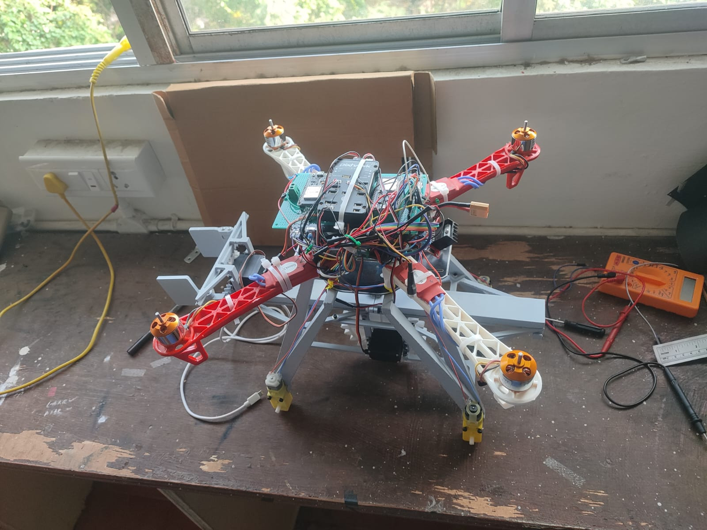

# Hybrid Ground–Aerial Warehouse Robot

A single platform that drives on the warehouse floor, flies over obstacles or up to
elevated racking, and performs pick-and-place with an onboard rack-and-pinion
manipulator — the ground base and the arm operated from a phone browser over the
robot's own WiFi.



**Demo:** [`media/demo.mp4`](media/demo.mp4) — the browser UI driving the
rack-and-pinion lift and the gripper. Mechanism close-up:
[`media/manipulator-rack-and-pinion.jpg`](media/manipulator-rack-and-pinion.jpg).

> B.Tech major project (2026–27) · Electronics & Instrumentation Engineering
> (Automation & Robotics) · SRM Institute of Science and Technology, Kattankulathur

---

## Status

Honest, because the alternative is being caught out by anyone who opens the code.

| Subsystem | Operated by | State |
|---|---|---|
| Ground base — drive, steering | ESP32 + browser UI over its own WiFi | **validated end to end** |
| Manipulator — rack lift, gripper | same UI, same ESP32 | **validated end to end** |
| Aircraft | RC transmitter into Pixhawk RCIN, Mission Planner as GCS | **flown** |
| ESP32 ⇄ Pixhawk MAVLink bridge | — | **implemented in firmware, not connected** |

The firmware on the robot (`firmware/hybridbot/`) contains a full MAVLink client —
heartbeat, RC override, mode set, arm/disarm, telemetry decode. None of it reaches an
autopilot, because the TELEM2 cable has been removed. The two halves are therefore
**independent systems sharing a frame and a power board**. That is a deliberate scope decision, not an unfinished task: ground operation and
flight were each working, and rewiring a working aircraft to chase a link it does not
need was judged a worse use of the remaining time. Unifying them under one interface
is recorded as future work — issue O1 in
[`docs/07-open-issues.md`](docs/07-open-issues.md).

---

## Why this is not just a drone with wheels

Ground robots cannot reach an elevated bin. Drones cannot carry a useful payload for
long. The engineering is in making **one** vehicle do both without doubling the mass,
and in keeping the manipulator usable — which is what forces the control split below.

| Capability | How | State |
|---|---|---|
| Ground transport | 4× TT gearmotors, differential drive, L298N | validated |
| Aerial traverse | Quad X, ArduCopter on a Pixhawk 2.4.8 with GPS | flown on RC |
| Pick and place | Rack-and-pinion lift + gripper, 2× MG995 | validated |
| Single operator interface | browser UI, MAVLink bridge to the autopilot | **implemented, not connected** |

Nothing above is claimed as working that is not.

---

## Architecture

The one structural decision: **nothing on the ESP32 stabilises the aircraft.** An
earlier iteration tried exactly that and was abandoned — see
[`docs/archive/ardupilot-on-esp32-SUPERSEDED.md`](docs/archive/ardupilot-on-esp32-SUPERSEDED.md).
Attitude and altitude belong to ArduPilot on dedicated hardware with a real sensor
suite.

```
   Browser (phone or laptop)
   http://192.168.4.1
          |
          |  WebSocket over the robot's SoftAP
          v
   +---------------------------+
   |          ESP32            |
   |  - SoftAP + web UI        |
   |  - ground drive (LEDC)    |---> L298N ---> 4x TT gearmotor
   |  - manipulator (LEDC)     |---> 2x MG995 (rack + gripper)
   |  - MAVLink translator     |
   +---------------------------+
          :
          :  UART2 @115200, MAVLink 2  -- GPIO13 -> TELEM2 RX, GPIO34 <- TELEM2 TX
          :  *** NOT CONNECTED. Cable removed from the vehicle. Issue O1 ***
          v
   +---------------------------+            +---------------------+
   |   Pixhawk 2.4.8           |<-- RCIN ---|  RC transmitter     |
   |   ArduCopter + GPS        |            |  Mission Planner GCS|
   |   attitude, altitude, pos |            +---------------------+
   +---------------------------+
          |
          +--> MAIN OUT 1-4 ---> 4x ESC ---> 4x A2212
```

That dotted path is what the firmware implements and the vehicle does not currently
use. Everything solid is working hardware.

---

## Repository layout

```
firmware/
  hybridbot/                THE firmware on the robot: ground drive, manipulator,
                            browser UI, plus a MAVLink client that is currently inert
  hybridbot_fly/            integration build, NOT flashed: adds UART diagnostics,
                            MAVLink data-stream requests, arm commandable in flight
  drive_arm_combined/       bench sketch: wheels and arm over a serial console
  ground_drive_test_v4/     drive-only fault isolation
  manip_bringup/            arm-only, calibrated travel limits
  esc_tuner_v2/             ESC bench tool, from before the Pixhawk
  archive/                  superseded. Do not flash
hardware/
  cad/                      STEP, STL and renders of the printed base and manipulator
  tests/                    weight, thrust, CG and supply measurements
docs/                       architecture, wiring, bring-up, FC setup, safety, issues
media/                      demo video and stills
```

Read [`firmware/README.md`](firmware/README.md) before flashing anything — the two
`hybridbot_*` builds differ in ways that matter, and `platformio.ini` will happily
build the one you did not mean to.

---

## Quick start

**Props off for everything below.**

1. Flash `firmware/drive_arm_combined/` to the ESP32. Serial at 115200, type `pins` —
   no line may report `HELD HIGH`. Run `combo`. A reset here is a power fault, not a
   code fault.
2. Set up the Pixhawk per
   [`docs/04-pixhawk-ardupilot-setup.md`](docs/04-pixhawk-ardupilot-setup.md). Motor
   Test must match the frame diagram before anything else.
3. Flash `firmware/hybridbot/`. Join WiFi `HybridBot`, open `http://192.168.4.1`,
   *Add to Home Screen*.
4. Drive and arm from the GROUND tab.
5. For the flight half, fit the TELEM2 cable, flash `firmware/hybridbot_fly/`
   instead — it has the receive diagnostics — and work
   [`docs/07-open-issues.md`](docs/07-open-issues.md) O1.

Staged procedure: [`docs/03-bringup-procedure.md`](docs/03-bringup-procedure.md).

### Dependencies

| Library | Needed by | Source |
|---|---|---|
| WebSockets (Markus Sattler) | `hybridbot`, `hybridbot_fly` | Arduino Library Manager |
| MAVLink `c_library_v2` | `hybridbot`, `hybridbot_fly` | [github.com/mavlink/c_library_v2](https://github.com/mavlink/c_library_v2) → unzip into `Arduino/libraries/c_library_v2/` |
| — | every other sketch | deliberately dependency-free |

---

## Pinout (authoritative)

One ESP32 on the vehicle. The second ESP32 that earlier revisions used as a flight
board has been removed; plans in `docs/archive/` are superseded by this table.

| Function | GPIO | Notes |
|---|---|---|
| L298N ENA | 5 | strapping pin; pulses at boot |
| L298N IN1 | 12 | MTDI strapping pin |
| L298N IN2 | 14 | emits a PWM burst from the ROM bootloader |
| L298N IN3 | 27 | |
| L298N IN4 | 26 | |
| L298N ENB | 25 | |
| Rack servo | 2 | strapping pin; disconnect to flash |
| Gripper servo | 4 | |
| MAVLink TX → TELEM2 RX | 13 | cable not currently fitted |
| MAVLink RX ← TELEM2 TX | 34 | input-only pin, correct for RX |

**Fit 10 kΩ pulldowns from ENA, IN1, IN2, IN3, IN4 to GND at the L298N.** The driver
has none internally and those pins move before user code runs.

### LEDC channel map — do not let the core auto-allocate

| Channels | Timer | Config | Drives |
|---|---|---|---|
| 0, 1 | timer0 | 1 kHz, 8-bit | ENA, ENB |
| 2, 3 | timer1 | 50 Hz, 16-bit | rack, gripper |

Channels pair onto timers two at a time. A servo landing on timer0 reprograms it to
50 Hz and the motor PWM becomes a 50 Hz chopper. Every `ledcAttach` names its channel
explicitly for this reason.

### Manipulator travel (measured)

| Joint | Range | Convention |
|---|---|---|
| Rack-and-pinion lift | 180° → 40° | 180° retracted, 40° fully extended |
| Gripper | 0° → 60° | 0° closed, 60° open |

---

## Power

Worst-case simultaneous stall draw is over **9 A**: ~4.4 A across the four drive
motors, up to 5 A across two MG995 servos.

- Servos on their own 5–6 V BEC rated ≥ 6 A, **never off the ESP32's regulator** —
  this is how the vehicle is built.
- Drive motors from the pack through the L298N.
- All grounds commoned, ESP32 included.

Distribution is on a **single perfboard** shared by the flight and ground stages, and
the Pixhawk takes its supply from that shared rail rather than from a dedicated power
module. That coupling is unmeasured and is issue B2 — see
[`docs/02-wiring-and-power.md`](docs/02-wiring-and-power.md) for the one measurement
that settles it.

---

## Team

| | Scope |
|---|---|
| **Shri Viswath C K** | Firmware, browser UI and control architecture; MAVLink bridge; electronics design, wiring and bring-up; documentation |
| **Rishav Kamboj** | Mechanical design and CAD; 3D printing; build and assembly of the ground platform and manipulator; airframe integration |

Electronics mounting and final assembly were done jointly.

Project guide: **Sam Jeba Kumar**, Professor, Dept. of Electronics & Instrumentation
Engineering, SRMIST.

Commit history is the record of who built what — mechanical work is committed by its
author rather than bulk-uploaded. **The `hardware/cad/` directories are empty by
design**: Rishav joins as a collaborator and pushes the CAD himself in January, after
the holiday period. See [`CONTRIBUTING.md`](CONTRIBUTING.md).

---

## Paper

A paper on this platform is in preparation for an IEEE / Scopus-indexed venue,
targeting submission by March 2027. If you use this work, see
[`CITATION.cff`](CITATION.cff).

If the target venue reviews double-blind, do not link this repository from the
submission — link an anonymised mirror (anonymous.4open.science) instead, or state
that code will be released on acceptance.

---

## Licence

[MIT](LICENSE), covering firmware, documentation and hardware design files alike.

Third-party components — ArduPilot, the MAVLink C library, the WebSockets library —
remain under their own licences and are not vendored here.
